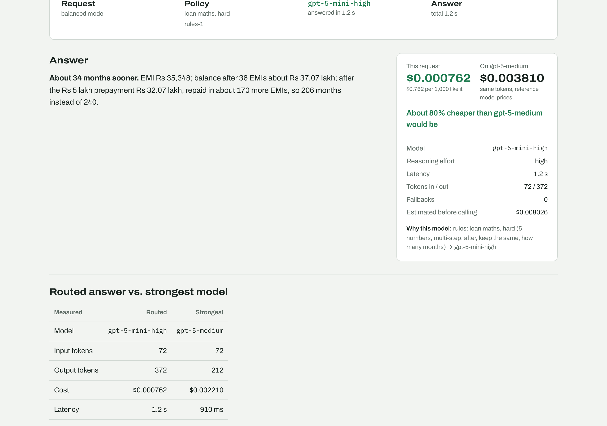

# Model Router: cost-aware routing across OpenAI models

One OpenAI-compatible API that apps call instead of a single model. For each request it picks the cheapest model that meets a measured quality bar, enforces hard cost and execution limits, falls back on failures, and records why it chose what it chose.

> Project 2 of my AI portfolio series. All evaluation data is public or synthetic.

**Status: session 1 of 10 complete, plus an early playground and a rule-based router.** Each request is classified by hand-written rules (category, difficulty, JSON output) and routed to a matching model; the playground shows the route, the reason and the cost, and can compare any answer with the strongest model. The benchmark and the calibrated routing policy come next (see [Roadmap](#roadmap)).



## What works now

- **OpenAI-compatible endpoint** `POST /v1/chat/completions`: any app using the OpenAI SDK can switch by changing its base URL
- **Bounded execution:** 20 s per call, 45 s per request, at most 4 model calls, 2 fallback hops and 1 retry per call. No path can loop or run up cost
- **Fallback chain** with error categories: rate limits and server errors are retried once and then fall back, a timeout falls back at once; a bad key or bad request stops immediately
- **Circuit breaker:** a model that fails 5 times in a row is skipped for 60 s
- **Cost from real token usage** and prices in one file (`models.yaml`), including billed calls that returned nothing usable
- **Budget rules:** per-request limit (callers can only lower it), downgrade only within the qualifying chain, a clear `budget_too_low` refusal, and a daily budget
- **Security:** request-size limit, `max_tokens` cap, per-client rate limits, optional API keys, admin-only model override, expensive models kept out of the public demo
- **Privacy:** only routing metadata is logged, never prompt text (a local-only debug mode stores redacted text for 7 days)
- **Rule-based routing (`rules-1`):** hand-written rules read the question and pick a category (customer complaint, loan maths, document extraction, SQL, Python, live web question, general) and a difficulty (easy, medium, hard) from signals such as multi-step wording, how many numbers or fields it has, and how many separate issues a complaint raises. `rules_policy.yaml` maps each category and difficulty to a model chain. A request for JSON never starts on the tiny tier. Cheapest and Quality modes route one level easier or harder. Live web questions (weather, news, today's prices) go to OpenAI's web-search models, which add a fee per search; no other question can reach them. The rules are a baseline written before any benchmark data exists; session 6 replaces the table with one generated from measured results
- **Compare with the strongest model:** the same question on gpt-5 (the reference model), shown side by side with measured tokens, cost and latency. No quality score is invented for free-form questions; scored comparisons come with benchmark mode
- **Honest cost labels:** every cost says whether it is *calculated* (real token usage x the price list, with the date it was checked) or *simulated* (demo mode). Neither is the OpenAI bill, and no savings figure is presented as a benchmark result
- **Routing metadata on every response:** chosen model, reason, policy version, attempts, fallbacks, estimated and actual cost, cost if the reference model had been used

## Architecture (current)

```
client ──► /v1/chat/completions
             │ size limit → API key → rate limit
             ▼
           policy.decide()          rules today (category, difficulty, JSON); calibrated policy later
             │
           budget rules             downgrade within the chain, or refuse
             │
           executor.run_chain()     timeout · deadline · retries · fallbacks · call limit · breaker
             │
           LiteLLM ──► OpenAI
             │
           tracker.log()            metadata only (SQLite)
```

## Model pool

| Option | Model | Tier | Reasoning effort | Input / Output per 1M tokens |
|---|---|---|---|---|
| gpt-5-nano-minimal | gpt-5-nano | tiny | minimal | $0.05 / $0.40 |
| gpt-4.1-nano (disabled: not available on this account) | gpt-4.1-nano | tiny | none | $0.10 / $0.40 |
| gpt-4.1-mini | gpt-4.1-mini | mid | none | $0.40 / $1.60 |
| gpt-5-mini-low | gpt-5-mini | mid | low | $0.25 / $2.00 |
| gpt-4.1 | gpt-4.1 | strong | none | $2.00 / $8.00 |
| gpt-5-mini-high | gpt-5-mini | reasoning | high | $0.25 / $2.00 |
| gpt-5-medium | gpt-5 | reasoning | medium | $1.25 / $10.00 |

Prices checked 2026-10-28; confirm on [openai.com/api/pricing](https://openai.com/api/pricing) before each benchmark run. The same model at two reasoning-effort levels is two options, because cost and latency differ a lot.

---

## Setup (Windows PowerShell)

You need Python 3.12 and an OpenAI API key.

```powershell
cd C:\Projects\model-router\router
python -m venv .venv
.venv\Scripts\activate
pip install -r requirements.txt
copy .env.example .env
notepad .env          # set OPENAI_API_KEY and ADMIN_API_KEYS
```

### 1. Run the tests (free, no API calls)

```powershell
python -m pytest
```

You should see `135 passed`. They use scripted fake models and LiteLLM's offline mock mode.

### 1b. Run the loan-maths calculator tests (from the project root)

```powershell
cd C:\Projects\model-router
router\.venv\Scripts\python -m pytest
```

You should see `66 passed`. Loan-maths answers are never trusted from a model: `data_gen/finance.py` computes EMI, balances, prepayment effects, FOIR, LTV and fees with stated rounding rules, and the benchmark grades model answers against it.

### 2. Check every model with one real call (usually under 1 cent; worst case 5 cents)

```powershell
python scripts/check_models.py
```

Each option should show `ok`. `not_found` means your account can't use that model: set `enabled: false` for it in `app/models.yaml`.

### 3. Start the API

```powershell
python -m uvicorn app.main:app --reload --port 8000
```

Open http://localhost:8000/docs.

### 4. Ask it something

PowerShell:

```powershell
$body = '{"model":"auto","messages":[{"role":"user","content":"Classify this complaint: I was charged twice for one purchase"}]}'
Invoke-RestMethod -Method Post -Uri http://localhost:8000/v1/chat/completions -ContentType 'application/json' -Body $body | ConvertTo-Json -Depth 6
```

Or with the OpenAI Python SDK:

```python
from openai import OpenAI

client = OpenAI(base_url="http://localhost:8000/v1", api_key="unused-unless-REQUIRE_API_KEY")
r = client.chat.completions.create(
    model="auto",
    messages=[{"role": "user", "content": "EMI on Rs 10 lakh at 10% for 5 years?"}],
    extra_body={"router": {"mode": "balanced", "max_cost_usd": 0.01}},
)
print(r.choices[0].message.content)
print(r.model_extra["router"])   # routed_to, reason, cost_usd, fallbacks_used, ...
```

### 5. Start the playground (second PowerShell window)

You need Node.js 20 or newer.

```powershell
cd C:\Projects\model-router\frontend
npm install
copy .env.example .env.local
npm run dev
```

Open http://localhost:3000. Click an **Easy** and then a **Hard** example: each is asked straight away. You'll see:

- **Route trace:** every step the request took. A red mark is a failed attempt, an amber track is a retry or fallback, green is the model that answered.
- **Compare with gpt-5-medium:** the same question on the strongest model, with tokens, cost and latency side by side.
- **Answer** and a **receipt:** actual cost, what the reference model would have cost for the same tokens, latency, tokens, and why that model was chosen.
- **This session:** your requests; click one to see its trace again.
- **Models** tab: the pool and prices. **Usage** tab: totals, savings, p50/p95 latency, fallback rate.

### Try it for free: demo mode

In `router\.env` set `DEMO_MODE=true` and restart uvicorn. Answers are scripted and nothing is sent to OpenAI, but routing, retries, fallbacks, limits and cost arithmetic are the real code. Add `#outage` to a prompt (or click **Simulate an outage**) to watch the primary model fail, retry and fall back. Set it back to `false` for real answers.

### 6. Frontend tests (free, the API is mocked)

```powershell
cd C:\Projects\model-router\frontend
npx playwright install chromium    # first time only
npm run test:e2e
```

You should see `44 passed` (22 tests on desktop and mobile).

## API

| Method | Path | Purpose |
|---|---|---|
| POST | `/v1/chat/completions` | OpenAI-compatible chat. `model: "auto"` routes; a specific option id needs an admin key |
| GET | `/v1/models` | OpenAI-compatible model list |
| GET | `/api/models` | Model pool with tiers and prices |
| GET | `/api/stats` | Requests, answered %, spend vs. reference model, p50/p95 latency, fallback rate |
| GET | `/api/health` | Status, policy version, circuit breakers |

Router extension in the request body (callers can only tighten limits):

```json
"router": {"mode": "cheapest | balanced | quality", "max_cost_usd": 0.01, "max_latency_ms": 10000}
```

Errors use the OpenAI shape `{"error": {"message", "type", "code"}}`:

| Status | Code | When |
|---|---|---|
| 400 | `invalid_request`, `budget_too_low`, `unknown_model`, `stream_not_supported` | Bad input, or no qualifying model fits the cost limit |
| 401 | `unauthorized` | Missing or invalid API key |
| 403 | `model_override_forbidden`, `model_not_allowed` | Forcing a model without an admin key |
| 402 | `budget_exhausted` | Cost limit reached before a valid answer |
| 413 | `request_too_large` | Body over 8 KB |
| 429 | `rate_limited`, `daily_limit_reached`, `daily_budget_reached` | Limits |
| 502 | `upstream_error` | Provider rejected the request (for example a bad key) |
| 503 | `all_models_failed`, `call_limit_reached` | Fallbacks used up |
| 504 | `deadline_exceeded` | 45 s request deadline passed |

## Project structure

```
model-router/
├── router/
│   ├── app/
│   │   ├── main.py          # FastAPI app and endpoints
│   │   ├── service.py       # request path: decide → budget → execute → log
│   │   ├── executor.py      # timeouts, retries, fallback chain, call limit, budget
│   │   ├── breaker.py       # circuit breaker
│   │   ├── registry.py      # model pool + cost arithmetic
│   │   ├── policy.py        # RulesPolicy (default), StaticPolicy; calibrated policy later
│   │   ├── rules.py         # category, difficulty and JSON signals from the question
│   │   ├── rules_policy.yaml # category x difficulty → model chain (hand-written)
│   │   ├── tracker.py       # metadata-only SQLite log, redaction
│   │   ├── limits.py        # rate limits
│   │   ├── auth.py          # API keys, roles
│   │   ├── schemas.py       # request and error shapes
│   │   ├── config.py        # every limit as a setting
│   │   ├── models.yaml      # model pool and prices
│   │   ├── thresholds.yaml  # quality bars (used from session 6)
│   │   └── workloads.yaml   # traffic mixes (used from session 6)
│   ├── scripts/check_models.py
│   └── tests/               # 135 tests, no API cost
├── frontend/                # Next.js playground + 44 Playwright tests
├── data_gen/
│   ├── finance.py           # deterministic loan maths: source of truth for loan answers
│   └── tests/               # 66 tests against reference values and invariants
├── evals/                   # sessions 2-6, 9
├── classifier_training/     # session 5
├── policies/                # versioned routing policies (session 6)
├── docs/PROGRESS.md
└── .github/workflows/ci.yml
```

## Roadmap

| # | Session | Status |
|---|---|---|
| 1 | Skeleton, model pool, executor, limits, cost and latency logging, API | Done |
| 2 | Data generators, difficulty-labelling rules, five-way split, leakage check | Next |
| 3 | Graders, grader checks, code sandbox | |
| 4 | Benchmark matrix with confidence intervals | |
| 5 | Rules-only router, classifier, misrouting analysis | |
| 6 | Calibration, confidence-aware selection, strategy comparison | |
| 7 | Validator, failure simulation, fallback quality | |
| 8 | Security review | |
| 9 | Full benchmark, `EVAL_REPORT.md` | |
| 10 | Leaderboard, decision trace from the calibrated policy, deploy | Playground started early |
